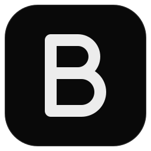

<p align="center">
  
</p>

<h1 align="center">Berland</h1>

<p align="center">
  Un orquestador local de agentes de IA. Conversas con la mente, ella reparte el trabajo entre Claude, Codex y agy,
  y cada tarea corre en su propio worktree.
</p>

---

## Qué hace

- **Chat con la mente.** Le das un plan o una pregunta y elige el modo: plan, auto, bypass o chat. Divide el trabajo en
  tareas, te las propone y las delega a la flota.
- **Flota de agentes.** Claude (SDK de agentes, con tu clave de API), Codex CLI y Antigravity (`agy`) trabajan en
  paralelo. Cada tarea va en un worktree propio y pasa por un gate (`npm run -s check` o el que defina el proyecto) antes
  de integrarse. También hay modo local, para carpetas sin git.
- **Tablero y panel en vivo.** Ves qué hace cada agente y subagente, el estado de cada tarea y su detalle.
- **Uso y gasto.** Muestra los tokens y el gasto por modelo, el cupo restante de Codex y agy, y aplica topes de gasto a
  la mente (por turno y por día).
- **Plugins.** Usa tu Chrome personal (cada agente con sus propias pestañas, sin ver tus cookies) y Canva, con reglas
  según el modo.
- **Memoria y skills.** Hay memoria del proyecto en Obsidian, para no repetir contexto, y un gestor de skills con
  cuarentena.
- **Local y sin login.** El núcleo escucha solo en `127.0.0.1` y pide un token. Las claves se guardan cifradas con DPAPI.

## Cómo está hecho

| Parte | Dónde | Con qué |
|---|---|---|
| Núcleo | `src/core/` | TypeScript sobre Node 24 (`node:sqlite`), Hono, Claude Agent SDK |
| Contratos | `src/shared/` | Zod y tipos compartidos |
| Interfaz | `src/ui/` | React 19, HeroUI y zustand, compilada con Vite |
| Escritorio | `apps/desktop/` | Electron |
| Pruebas | `tests/` | Vitest; las pruebas en vivo están en `tests/live/` y solo corren con `ORQ_LIVE=1` |
| API | `docs/api/` | OpenAPI y colección de Postman, generadas desde las rutas reales |

## Levantar Berland (Windows)

Requisitos: Windows con Node 24 en el `PATH`.

```powershell
cd C:\dev\orquestador
npm ci
node node_modules\electron\install.js
npm run -s check          # typecheck, lint, pruebas y los dos builds
npm run desktop           # compila el escritorio y abre Berland
```

- **Acceso directo en el Escritorio.** Se crea una sola vez:
  `powershell -NoProfile -ExecutionPolicy Bypass -File scripts\desktop-shortcut.ps1`.
- **Solo el núcleo** (para la API, Postman o la CLI): `node src/core/app/cli.ts iniciar`. Escucha en
  `127.0.0.1:47811`.
- **Desde WSL.** Todo pasa por `scripts/win.sh`, que usa el Node de Windows: `scripts/win.sh npm run -s check < /dev/null`.

El paso a paso completo, con el modo desarrollo de la interfaz y las pruebas en vivo, está en
[inssues/README.md › Cómo levantar todo](inssues/README.md).

## Issues

Las fallas conocidas, cada una con su diagnóstico, su arreglo propuesto y la prueba que la cubre, están en
[`inssues/`](inssues/README.md). Una issue resuelta conserva su archivo con `Estado: resuelta`.

## Reglas para agentes

Ver [`AGENTS.md`](AGENTS.md): TypeScript estricto, `src/shared/` como contrato, sin claves en el código, pruebas en
`tests/` y un worktree por tarea.
